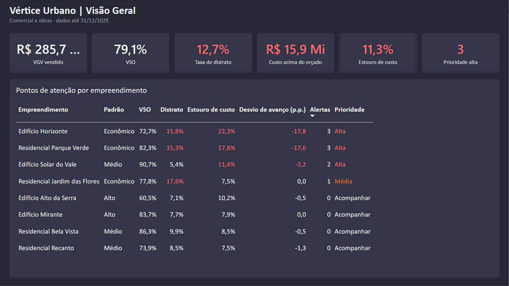
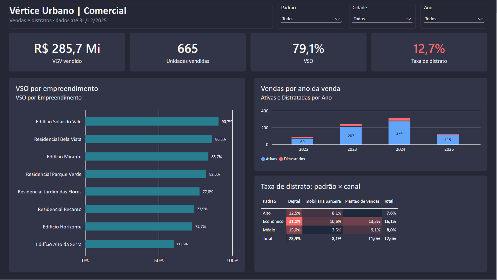
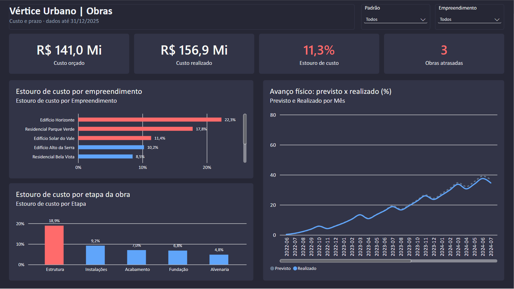

# 🏗️ Vértice Urbano: Painel de Vendas e Obras no Power BI

Estudo de caso de análise de dados de uma **construtora e incorporadora fictícia**, do dado bruto ao painel executivo, seguindo a metodologia **CRISP-DM**.



## 📌 Sobre o projeto

A **Vértice Urbano** é uma construtora e incorporadora do interior de São Paulo que lançou **8 empreendimentos residenciais** entre 2022 e 2024, somando **841 unidades** em Campinas, Sorocaba e São José dos Campos.

Os números de venda pareciam bons, mas **o lucro não acompanhava**. Havia clientes desistindo da compra, obras acima do orçamento e entregas atrasadas, e cada área acompanhava os números numa planilha diferente.

O objetivo foi preparar e analisar os dados com **Python e SQL** e entregar à diretoria um **painel no Power BI** que reúne a frente comercial e a de obras e aponta **onde agir primeiro**.

## ❓ Perguntas de negócio

1. Como estão as vendas (**VGV vendido** e **VSO**) por empreendimento e ao longo do tempo?
2. Qual é a **taxa de distrato** e onde ela se concentra?
3. As obras estão **dentro do orçamento**? Em quais etapas o custo estoura?
4. As obras estão **no prazo**? Atraso e estouro de custo andam juntos?
5. Quais empreendimentos **precisam de atenção da diretoria**?

## 📊 Principais resultados

| Indicador | Resultado |
|---|---|
| VGV vendido | **R$ 285,7 mi** de R$ 379,5 mi |
| VSO acumulado | **79,1%** (665 de 841 unidades) |
| Taxa de distrato | **12,7%**, chegando a **31,0%** no Econômico vendido pelo canal Digital |
| Custo das obras | **R$ 15,9 mi acima do orçado (+11,3%)**, com a etapa de Estrutura em +18,9% |
| Obras atrasadas | **3 de 8**, as mesmas 3 com maior estouro de custo |

**Descobertas principais**

- O problema de lucro não está na venda, e sim no que acontece **depois** dela: distratos no comercial e estouro de custo e prazo nas obras.
- Os problemas se concentram nos **empreendimentos econômicos**.
- A combinação **Econômico + Digital** representa 13% das vendas, mas **32% dos distratos**.
- **3 empreendimentos em prioridade alta:** Edifício Horizonte, Residencial Parque Verde e Edifício Solar do Vale.

**Ações recomendadas:** plano de recuperação de cronograma e auditoria de custos nas obras críticas, análise de crédito antes da assinatura nas vendas digitais, e negociação do preço de aço e concreto nas obras ainda na fase de Estrutura. A tabela completa de ações está na Seção 8 do notebook.

## 🖥️ O painel

| Comercial | Obras |
|---|---|
|  |  |

- **Visão Geral:** indicadores principais e um "semáforo" de prioridade por empreendimento.
- **Comercial:** VSO, VGV, evolução das vendas e o mapa de distrato por padrão × canal.
- **Obras:** orçado x realizado por empreendimento e etapa, e as curvas de avanço físico previsto x realizado.

O painel também está disponível em PDF: [`construction_dashboard.pdf`](construction_dashboard.pdf).

## 🛠️ Ferramentas

| Etapa | Ferramenta |
|---|---|
| Geração dos dados fictícios | Python (pandas, NumPy) |
| Limpeza e análise exploratória | Python (pandas), SQL (SQLite), matplotlib e seaborn |
| Modelagem dos dados | Esquema estrela |
| Painel | Power BI (Power Query em M, DAX e tema personalizado em JSON) |
| Versionamento | Git e GitHub |

## ▶️ Como reproduzir

```bash
git clone https://github.com/ricardo-paganini/construction-powerbi-dashboard.git
cd construction-powerbi-dashboard
python -m venv venv
venv\Scripts\activate
pip install -r requirements.txt
python -m ipykernel install --user --name=construction-powerbi-venv --display-name="Python (construction-powerbi)"
jupyter notebook
```

1. Abra o `construction_analysis.ipynb`, escolha o kernel **Python (construction-powerbi)** e rode **Kernel > Restart & Run All**. Os arquivos `*_clean.csv` são gerados na raiz.
2. Abra o `construction_dashboard.pbix` no Power BI Desktop, vá em **Transformar dados** e troque o parâmetro **`project_folder`** pelo caminho da pasta do projeto no seu computador (terminando com `\`).
3. Clique em **Fechar e Aplicar**.

No Linux ou Mac, a ativação do ambiente é `source venv/bin/activate`. O passo a passo completo está na Seção 9 do notebook.

## 📁 Arquivos

| Arquivo | Descrição |
|---|---|
| `generate_data.py` | Gera as bases fictícias com semente fixa |
| `developments.csv`, `units.csv`, `sales.csv`, `construction_costs.csv`, `construction_progress.csv` | Bases originais, com problemas de qualidade propositais |
| `construction_analysis.ipynb` | Notebook com todo o projeto (CRISP-DM) |
| `*_clean.csv` | Bases limpas, lidas pelo Power BI |
| `construction_dashboard.pbix` | Painel no Power BI |
| `construction_dashboard.pdf` | Painel exportado em PDF |
| `theme.json` | Tema de cores do painel |
| `dashboard_*.png` | Imagens das páginas do painel |
| `requirements.txt` | Bibliotecas e versões usadas |

## ⚠️ Observação sobre os dados

Todos os dados deste projeto são **fictícios**, gerados pelo script `generate_data.py` com semente fixa. As relações de negócio (como a maior taxa de distrato no canal digital) foram embutidas de propósito, para que a análise tivesse padrões a descobrir. Os problemas de qualidade (duplicados, nulos, textos escritos de formas diferentes e datas impossíveis) também foram criados de propósito, para praticar a limpeza. Qualquer semelhança com empresas reais é coincidência.
